# 🚀 Awesome Cloud Desktop & Virtual Machine Management

  

  
  
  
  
  
  
  

---

## 🌟 Top Cloud Desktop & Virtual Machine Management Ecosystem

> **A curated directory of SaaS/Hosted platforms, self-hosted hypervisors, and open-source GitHub projects for Virtual Desktop Infrastructure (VDI), Browser-Based Cloud Workspaces, Hypervisor Management, Remote GPU Workstations & Containerized Desktops.**

**SEO & Discovery Keywords**: `cloud-desktop` • `virtual-machine-management` • `vdi` • `daas` • `proxmox` • `qemu-kvm` • `webrtc-streamer` • `remote-desktop` • `docker-desktop` • `hypervisor` • `cloud-workstations` • `awesome-list`

**Last updated: November 2026**

---

### 📖 Overview

This repository tracks notable **SaaS/hosted platforms** and **open-source projects** for **Cloud Desktop & Virtual Machine Management**. These tools provision, stream, orchestrate, isolate, and manage remote Windows, Linux, and macOS virtual desktops, GPU workstations, and browser-rendered containers across enterprise VDI clouds, bare-metal hypervisors, and self-hosted homelabs.

- **Enterprise & SaaS Leaders**: Includes Shadow PC, Paperspace Core, Amazon WorkSpaces, Microsoft Dev Box & Windows 365, Citrix DaaS, Omnissa Horizon Cloud (formerly VMware Horizon Cloud), Kasm Workspaces, AppOnFly, Dizzion Frame (formerly Frame by Nutanix), and V2 Cloud.
- **Open-Source Powerhouses**: Heavily expanded with every major active project for self-hosted hypervisor orchestration (`Proxmox VE`, `XCP-ng`, `Incus`, `KubeVirt`, `OpenNebula`, `Harvester`), containerized browser-streamed desktops (`KasmVNC`, `Neko`, `LinuxServer Webtop`, `Selkies-GStreamer`), clientless remote gateways (`Apache Guacamole`), containerized OS virtual machines (`dockur/windows`, `sickcodes/Docker-OSX`, `dockur/macos`), fast remote desktop clients (`RustDesk`), and ultra-low-latency GPU streamers (`Sunshine + Moonlight`).

Contributions welcome! Open a PR to add/update entries. Keep descriptions factual and link to official sites.

---

## 📑 Table of Contents

- [📊 Sector Overview & Market Dynamics](#-sector-overview--market-dynamics)
- [☁️ SaaS/Hosted Platforms](#️-saashosted-platforms)
- [🔓 Open-Source GitHub Projects](#-open-source-github-projects)
  - [⭐ Featured Open-Source Projects (Ranked by Stars)](#-featured-open-source-projects-ranked-by-stars)
  - [🛠️ Hypervisors, MicroVMs & Base Virtualization](#️-hypervisors-microvms--base-virtualization)
  - [🏗️ Recommended Architecture Stacks](#️-recommended-architecture-stacks)
- [🤝 How to Contribute](#-how-to-contribute)
- [💖 Support & Share](#-support--share)
- [📈 Star History](#-star-history)
- [⚠️ Disclaimer](#️-disclaimer)

---

## 📊 Sector Overview & Market Dynamics

The global Cloud Desktop and Desktop-as-a-Service (DaaS) market is estimated at **$8.4B to $11.5B by 2026**, expanding at a double-digit CAGR (~11–19%) fueled by hybrid enterprise workforces, remote developer onboarding, and zero-trust security adoption. 

The sector exhibits a pronounced **barbell structure**:
- **Highly Concentrated at the Hyperscaler & Core Infrastructure Layer**: Dominated by Microsoft (Azure Virtual Desktop / Windows 365), Amazon Web Services (Amazon WorkSpaces), and enterprise legacy titans like Citrix (Cloud Software Group) and Omnissa (formerly VMware EUC), creating an oligopolistic control plane over core Windows enterprise licensing and enterprise cloud hosting.
- **Moderately Fragmented at the Edge & Application Layer**: A thriving ecosystem of agile vendors and specialized providers competes fiercely on developer workstation speed, cost-effective SME hosting, multi-cloud flexibility, low-latency GPU creative workstations, and browser-native containerized desktop streaming (CDI).

---

## ☁️ SaaS/Hosted Platforms

> All SaaS products are evaluated based on their starting tier prices, free tier / trial capabilities, and organized by company valuation / scale in descending order.

| 🏢 Platform | 💰 Company Valuation / Revenue Scale | 🏷️ Starting Price | 🎁 Free Tier Limits / Free Trial | 📝 Description |
| :--- | :--- | :--- | :--- | :--- |
| **[Microsoft Dev Box & Windows 365](https://microsoft.com)** | **~$3.6T Market Cap** (~$261.8B–$305.5B FY Revenue) | **$28.00 / user / month** (Basic 2 vCPU, 4GB RAM, 128GB Cloud PC) | **1-month free trial** for Windows 365 Business (limited to 1 user license per tenant; credit card required). | Cloud-hosted developer workstations and Cloud PCs pre-configured with project repositories, IDEs, and enterprise Intune governance. |
| **[Amazon WorkSpaces (AWS)](https://amazon.com)** | **~$2.4T Market Cap** (~$638B–$717B FY Revenue) | **$7.25 / month + $0.22 / hour** (AutoStop Value tier) or **$25.00 / month** (AlwaysOn flat tier) | **Up to 3-month free trial / $200 AWS credit**: provides 2 Standard AutoStop WorkSpaces up to 40 combined hours/month (80GB root + 50GB user volumes) or 5 Performance Ubuntu WorkSpaces up to 100 hours/month. | Fully managed, persistent cloud Virtual Desktop Infrastructure (VDI) service delivering Windows, Linux, and Ubuntu desktops with global low-latency streaming. |
| **[Citrix DaaS](https://citrix.com)** | **~$16.5B Buyout Valuation** (CSG: ~$3.2B+ ARR) | **$10.00 / user / month** (Baseline DaaS control plane subscription) | **60-day free trial** for Citrix Cloud / DaaS evaluation supporting up to 25 test users (cloud infrastructure compute billed separately or BYO-cloud). | Enterprise hybrid-cloud VDI platform providing HDX remote display protocols, granular security policies, and virtualized app/desktop delivery. |
| **[Omnissa Horizon Cloud](https://omnissa.com)** | **~$4.0B Acquisition Valuation** (~$1.5B ARR) | **$4.67 / user / month** (Horizon Apps) / **$5.79 / user / month** (Horizon Standard VDI subscription) | **30-day proof-of-concept / evaluation free trial** via Azure Marketplace / AWS Marketplace on-demand trial registration. | Cloud-managed VDI and published application platform scaling virtual desktops across Microsoft Azure, Amazon WorkSpaces Core, and on-premise vSphere. |
| **[Paperspace Core (DigitalOcean)](https://paperspace.com)** | **~$4.5B Parent Market Cap** (DigitalOcean: ~$780M–$901M Annual Revenue) | **$0.0045 / hour** (C1 CPU VM) / **$0.45 / hour** (Entry Quadro/NVIDIA GPU workstation) | **No free tier/trial for Core VMs** (all provisioned Core desktops bill by the hour; free tier is restricted exclusively to Paperspace Gradient shared notebooks). | Cloud GPU virtual machine and desktop infrastructure offering low-latency browser streaming, persistent storage, and instant Linux/Windows workstation templates. |
| **[Dizzion Frame](https://dizzion.com)** | **~$100M+ Est. Enterprise Value** (~$16.7M–$24.6M Annual Revenue; backed by LLR Partners) | **$21.00 / user / month** (Platform orchestration control plane) | **14-day assisted enterprise proof-of-concept / trial evaluation** via cloud partner consultation or AWS Marketplace PoC. | Browser-native Desktop-as-a-Service platform streaming GPU-accelerated Windows and Linux applications directly into HTML5 browsers without client plugins. |
| **[Shadow PC](https://shadow.tech)** | **~€100M Est. Valuation** (~€20M Annual Revenue; Jezby Ventures / Synfonium) | **$29.99 / month** (Shadow PC Lite tier with dedicated Windows PC & GPU) | **No free trial or free tier available** (users must test bandwidth/latency via web diagnostics tool before subscribing). | High-performance cloud gaming and creative workstation service streaming dedicated Windows PCs equipped with discrete NVIDIA GPUs. |
| **[V2 Cloud](https://v2cloud.com)** | **~$15M–$25M Est. Valuation** (~$6M–$10M Annual Revenue) | **$60.00 / month** (Standard User plan) | **7-day risk-free trial** (full feature access with no long-term contract; cancel anytime). | All-in-one managed Desktop-as-a-Service (DaaS) solution featuring built-in cloud storage, ransomware protection, and HTML5 web-client access. |
| **[AppOnFly](https://apponfly.com)** | **~$10M–$15M Est. Valuation** (~$1M–$10.6M Annual Platform Sales) | **$0.06 / hour** (Pay-as-you-go hourly) or **$11.90 / month** (Start VPS plan) | **20-to-30 minute free web test session** (non-persistent temporary session for testing web browser Windows access without registration). | Instant cloud Windows VPS and remote desktop platform accessible via browser or RDP for running Windows software on macOS, Linux, and mobile devices. |
| **[Kasm Workspaces (Enterprise Cloud)](https://kasmweb.com)** | **~$9.6M Est. Valuation** (~$2.8M–$3.0M Annual Revenue) | **$5.00 / user / month** (Commercial Enterprise Basic license) | **Community Edition is 100% Free Forever** (capped at **5 concurrent sessions**, self-hosted on community support with core containerized browser and Linux desktop streaming). | Containerized Desktop Infrastructure (CDI) platform streaming isolated browser sessions, Linux desktops, and remote Windows VMs directly to web browsers. |

---

## 🔓 Open-Source GitHub Projects

### ⭐ Featured Open-Source Projects (Ranked by Stars)

The following repositories represent the leading open-source software projects across remote desktop streaming, containerized desktops, virtualization management, and VDI brokers. Sorted in descending order by GitHub stars:

1. **[RustDesk](https://github.com/rustdesk/rustdesk)**   
   ⚡ Open-source virtual/remote desktop client and self-hosted relay server software written in Rust. Acts as a complete, secure, full-control alternative to TeamViewer and AnyDesk with end-to-end encryption.

2. **[dockur/windows](https://github.com/dockur/windows)**   
   🪟 Windows inside a Docker container with KVM hardware acceleration, automatic ISO download, multi-version support (Windows 11, 10, Server), and an integrated HTML5 web browser viewer.

3. **[sickcodes/Docker-OSX](https://github.com/sickcodes/Docker-OSX)**   
   🍏 Run macOS (Sonoma, Ventura, Monterey) inside Docker with near-native KVM acceleration, X11 forwarding, and auto-provisioning for cloud CI/CD, remote macOS desktop testing, and security research.

4. **[Sunshine](https://github.com/LizardByte/Sunshine)**   
   🎮 Self-hosted low-latency game and desktop streaming host for Moonlight. Supports NVIDIA NVENC, AMD AMF, and Intel QuickSync hardware encoding for high-FPS 4K remote workstations and gaming desktops.

5. **[Neko](https://github.com/m1k1o/neko)**   
   🐱 Self-hosted, browser-rendered virtual desktop and isolated browser running in Docker streamed using WebRTC. Features multi-user synchronous cursor sharing and collaborative workspace sessions.

6. **[dockur/macos](https://github.com/dockur/macos)**   
   🖥️ Run macOS virtual machines inside Docker containers with KVM hardware acceleration, instant automated installation, and browser-accessible web console delivery.

7. **[Moonlight Qt](https://github.com/moonlight-stream/moonlight-qt)**   
   📱 Open-source cross-platform client for Sunshine and NVIDIA GameStream, delivering buttery smooth 120 FPS remote desktop streaming with HDR and surround audio support.

8. **[Cockpit](https://github.com/cockpit-project/cockpit)**   
   🎛️ Interactive web-based graphical server administration interface. Paired with `cockpit-machines`, it provides browser management for KVM virtual machines, storage pools, and virtual networking via `libvirt`.

9. **[QEMU](https://github.com/qemu/qemu)**   
   ⚙️ Generic and open-source machine emulator and virtualizer. Serves as the bedrock hypervisor for KVM, Proxmox, and modern Linux cloud virtualization platforms.

10. **[Distrobox](https://github.com/89luca89/distrobox)**   
    📦 Use any Linux distribution inside your terminal and export GUI applications directly into your host desktop using Podman/Docker with full seamless integration.

11. **[Multipass](https://github.com/canonical/multipass)**   
    🏎️ Lightweight CLI tool from Canonical to orchestrate fresh, cloud-init configurable Ubuntu virtual machine instances instantly on Linux, Windows, and macOS.

12. **[vastsa/PI-Desktop](https://github.com/vastsa/PI-Desktop)**   
    🥧 Lightweight open-source remote workspace and Linux desktop setup utility engineered to streamline personal virtual workspaces and developer remote environments.

13. **[KubeVirt](https://github.com/kubevirt/kubevirt)**   
    ☸️ Kubernetes virtualization technology add-on that enables declarative orchestration of legacy virtual machines alongside cloud-native containers in Kubernetes clusters.

14. **[Incus](https://github.com/lxc/incus)**   
    🐧 Community-led system container and virtual machine manager (forked from LXD) offering a unified CLI, REST API, and clustering for full Linux system containers and KVM virtual machines.

15. **[KasmVNC](https://github.com/kasmtech/KasmVNC)**   
    🚀 Modern web-native VNC server engineered for high-FPS, low-latency browser desktop streaming with WebP/AVIF encoding, audio pass-through, clipboard synchronization, and touch support.

16. **[Harvester](https://github.com/harvester/harvester)**   
    🌾 Modern open-source hyperconverged infrastructure (HCI) software built on Kubernetes, KubeVirt, and Longhorn, engineered as an open alternative to VMware vSphere and Nutanix.

17. **[LinuxServer.io Webtop](https://github.com/linuxserver/docker-webtop)**   
    🌐 Popular Docker images providing full Alpine, Ubuntu, Fedora, and Arch desktop environments (XFCE, KDE, i3, MATE) streamed directly into web browsers via Selkies and KasmVNC.

18. **[Apache Guacamole Server](https://github.com/apache/guacamole-server)**   
    🥑 Clientless open-source remote desktop gateway daemon supporting VNC, RDP, and SSH natively in HTML5 web browsers with zero client software or plugins required.

19. **[Selkies](https://github.com/selkies-project/selkies)**   
    🎥 Hardware-accelerated WebRTC remote desktop, cloud gaming, and application streaming platform built on GStreamer for low-latency GPU workstations.

20. **[OpenNebula](https://github.com/OpenNebula/one)**   
    ☁️ Simple, scalable open-source cloud and edge computing management platform orchestrating KVM virtual machines, LXC containers, Firecracker microVMs, and multi-tenant VDI.

21. **[libvirt](https://github.com/libvirt/libvirt)**   
    📚 The foundational C library, daemon, and API toolkit for managing platform virtualization technologies (KVM, QEMU, Xen, LXC, bhyve).

22. **[Xen Orchestra](https://github.com/vatesfr/xen-orchestra)**   
    🛡️ Complete web-based management, backup, and orchestration solution for XCP-ng and Citrix Hypervisor (XenServer) virtualization pools.

23. **[Proxmox VE Manager](https://github.com/proxmox/pve-manager)**   
    🏢 Web-based management interface for Proxmox VE, the premier enterprise open-source virtualization platform integrating KVM, LXC, Ceph storage, and software-defined networking.

24. **[OpenUDS](https://github.com/VirtualCable/openuds)**   
    🔀 Multi-platform open-source VDI connection broker that automates the provisioning and lifecycle of virtual desktops and applications across Proxmox, oVirt, KVM, and cloud providers.

---

### 🛠️ Hypervisors, MicroVMs & Base Virtualization

- **[Firecracker](https://github.com/firecracker-microvm/firecracker)**: Secure, fast minimal microVM engine written in Rust for serverless workloads and isolated short-lived compute environments.
- **[XCP-ng](https://xcp-ng.org)**: Turnkey open-source enterprise hypervisor based on Xen, offering hyper-converged clustering and seamless backup pipelines.
- **[oVirt](https://www.ovirt.org)**: Comprehensive enterprise distributed virtualization management platform built on KVM and Ansible.

---

### 🏗️ Recommended Architecture Stacks

- **Self-Hosted Homelab Cloud PC**: `Proxmox VE` (Compute/Storage) + `dockur/windows` or `dockur/macos` (OS runtime) + `Sunshine` + `Moonlight` (GPU streaming)
- **Zero-Trust Enterprise Remote Access**: `Incus` / `KVM` + `Apache Guacamole` (Browser Gateway) + `Tailscale` / `WireGuard`
- **Containerized Desktop-as-a-Service (CDI)**: `Kasm Workspaces Community Edition` + `KasmVNC` + `LinuxServer.io Webtop`
- **Kubernetes-Native Cloud Desktops**: `Harvester` / `KubeVirt` + `Selkies-GStreamer` (WebRTC)

---

## 🤝 How to Contribute

We welcome contributions from sysadmins, DevOps engineers, and virtualization enthusiasts!

1. 🍴 **Fork the repo** to your own GitHub profile.
2. 🌿 **Create a new branch** (`git checkout -b feature/new-tool`).
3. 📝 **Add/edit entries** following the established schema and include:
   - Official tool name and link
   - Accurate license and classification (SaaS vs. Open-Source)
   - Concise 1–2 sentence description
   - For open-source tools: valid GitHub repository star badge linking to `/stargazers`
4. 🚀 **Submit a Pull Request** with a descriptive summary of why the tool qualifies.

---

## 💖 Support & Share

If this curated repository saved you hours of research or helped you build your cloud desktop infrastructure, please consider supporting the project:

- ⭐ **Star this repository** on GitHub to help more builders and sysadmins discover it.
- 🍴 **Fork and contribute** new open-source and hosted developments.
- 📢 **Share the project** with your colleagues, DevOps team, and homelab community on Reddit, LinkedIn, X/Twitter, and Discord.
- ☕ **Buy me a coffee & support my open-source work**: Sponsor the ongoing curation and maintenance via the **[GitHub Sponsors Dashboard](https://github.com/sponsors/ishandutta2007)**. Every sponsorship provides direct recognition, README shoutouts, and helps keep these ecosystem resources continuously updated!

  

---

## 📈 Star History

---

## ⚠️ Disclaimer

- This is an independent, community-driven curated directory — inclusion does not imply formal endorsement or commercial sponsorship.
- **Security Precaution**: Exposing remote desktop gateways, VNC endpoints, or hypervisor dashboards directly to the public internet without proper authentication, reverse proxy TLS/HTTPS termination, zero-trust network tunnels, and MFA represents a critical security hazard. Always isolate your control planes behind secure VPN overlays (e.g., WireGuard, Tailscale) or reverse proxy gateways.
- **Licensing Compliance**: Always ensure strict adherence to OEM software licensing agreements (e.g., Microsoft Windows VDA licenses and Apple macOS virtualization EULAs) when provisioning virtualized instances.

---

  Built with ❤️ for DevOps engineers, cloud architects, sysadmins, and homelab builders worldwide.

